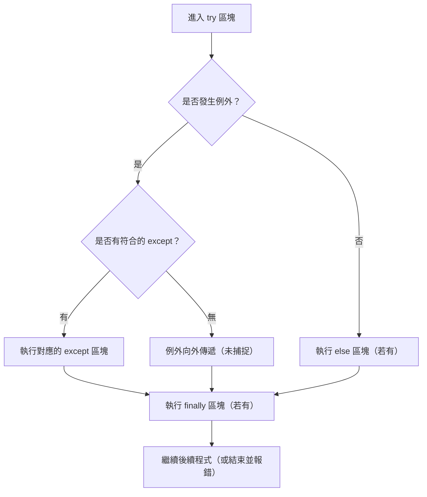

# Python 例外處理（`try...except`）：由淺至深完整指南

這份教材會帶你從認識錯誤訊息開始，循序漸進掌握 Python 的例外處理機制。課程分為四個階段：**基礎入門**、**精準控制**、**課堂實戰**、**深入實務**，並搭配 [calc.py](./calc.py) 與 [test_calc.py](./tests/test_calc.py) 的實例講解。請打開 VS Code 或終端機，跟著每個階段實際執行範例。

## 課程學習地圖與執行流程

在深入語法之前，先用一張流程圖看懂 `try...except...else...finally` 在程式執行時怎麼走：



---

## 第一階段｜基礎入門（觀念與核心語法）

### 1. 認識錯誤與例外：`SyntaxError` vs `Exception`

寫 Python 程式時遇到的問題主要分成兩大類，學習 `try...except` 前必須先分清楚：

- **語法錯誤（`SyntaxError`）**：程式碼不合 Python 文法（例如 `if` 少了冒號 `:`、括號未成對）。在程式**開始執行前**就會被攔下，**無法用 `try...except` 捕捉**，只能直接改對語法。
- **執行期例外（`Exception` / Runtime Error）**：語法完全正確，但程式**跑起來之後**遇到不合理的資料或環境狀況（例如除以 `0`、將非數字文字轉成整數、讀取不存在的檔案）而中斷。**`try...except` 就是用來處理這種執行期例外。**

```python
# 語法錯誤範例：if 結尾缺少冒號，程式連啟動都無法
# if True
#     print("Hello")
# SyntaxError: expected ':'

# 例外（執行期錯誤）範例：語法正確，但執行到第 2 行就會中斷
print("程式開始")
result = 10 / 0
print("程式結束")  # 這一行不會被執行到
```

執行輸出（Traceback 錯誤追蹤訊息）：

```text
程式開始
Traceback (most recent call last):
  File "demo.py", line 2, in <module>
    result = 10 / 0
             ~~~^~~
ZeroDivisionError: division by zero
```

#### 如何快速看懂 Traceback？

1. **先看最後一行**：立刻得知錯誤的**類型**（`ZeroDivisionError`）與**原因說明**（`division by zero`）。
2. **再往上看檔案與行號**：由下往上追查錯誤發生在哪一個檔案、第幾行（`line 2`）以及哪一段運算式。

---

### 2. 常見內建例外一覽表

| 例外類型 | 常見發生原因 | 最小觸發範例 |
| :--- | :--- | :--- |
| `ZeroDivisionError` | 除數或取餘數的分母為 `0` | `10 / 0` |
| `ValueError` | 型別對，但「內容值」不合法 | `int("abc")` |
| `TypeError` | 對不相容的型別進行運算或呼叫 | `"10" + 5` |
| `IndexError` | `list` / `tuple` 索引超出範圍 | `[1, 2, 3][5]` |
| `KeyError` | 存取 `dict` 時使用了不存在的鍵（key） | `{"a": 1}["b"]` |
| `FileNotFoundError` | 嘗試開啟不存在的檔案 | `open("missing.txt")` |

---

### 3. 第一個 `try...except`：攔截錯誤、避免程式崩潰

最基本的例外處理包含兩個區塊：
- **`try:`** 放入「可能會出錯的程式碼」。
- **`except 例外類型:`** 放入「萬一真的發生該錯誤時，要執行的補救動作」。

```python
def split_bill(total, people):
    try:
        per_person = total / people
        print(f"每人應付：{per_person:.0f} 元")
    except ZeroDivisionError:
        print("錯誤：分攤人數不能為 0！")

split_bill(600, 3)
split_bill(600, 0)
print("結帳流程繼續進行...")
```

執行輸出：

```text
每人應付：200 元
錯誤：分攤人數不能為 0！
結帳流程繼續進行...
```

> [!NOTE]
> 當 `people` 為 `0` 時，`total / people` 一出錯就會**立刻跳出 `try` 區塊**，因此下一行的 `print(f"每人應付：...")` 不會被執行，程式直接進入 `except ZeroDivisionError:`；處理完畢後，函式外部的 `print("結帳流程繼續進行...")` 仍能正常執行。

---

## 第二階段｜精準控制（多重捕捉與完整流程）

### 4. 多重 `except`、元組捕捉與 `as e`

同一段程式常常不只一種出錯可能。我們可以：
1. 串接多個 `except`，針對不同錯誤給出明確的提示。
2. 用元組 `(錯誤A, 錯誤B)` 一次接住採用相同處理方式的多種例外。
3. 加上 `as e` 取得例外物件本身，並透過 `type(e).__name__` 與 `{e}` 查看錯誤名稱與訊息。

```python
def calc_unit_price(total_text, count_text):
    try:
        total = int(total_text)
        count = int(count_text)
        unit_price = total / count
        print(f"單價：{unit_price:.1f} 元")
    except ValueError as e:
        print(f"輸入格式錯誤，請輸入整數！（系統訊息：{e}）")
    except ZeroDivisionError:
        print("數量不能為 0，無法計算單價！")

calc_unit_price("500", "4")
calc_unit_price("五百", "4")
calc_unit_price("500", "0")
```

執行輸出：

```text
單價：125.0 元
輸入格式錯誤，請輸入整數！（系統訊息：invalid literal for int() with base 10: '五百'）
數量不能為 0，無法計算單價！
```

如果多種例外只需要同一套處理方式，可以用元組合併捕捉，並在最後放上 `Exception` 作為保底防線：

```python
def get_item(data, index_text):
    try:
        index = int(index_text)
        print("取得項目：", data[index])
    except (ValueError, IndexError) as e:
        print(f"查詢失敗（輸入非整數或索引超出範圍）：{e}")
    except Exception as e:
        print(f"發生未預期的錯誤 [{type(e).__name__}]：{e}")

items = ["蘋果", "香蕉", "橘子"]
get_item(items, "1")     # 正常
get_item(items, "abc")   # 觸發 ValueError
get_item(items, "10")    # 觸發 IndexError
get_item(None, "0")      # 觸發 TypeError，由最後的 Exception 接住
```

執行輸出：

```text
取得項目： 香蕉
查詢失敗（輸入非整數或索引超出範圍）：invalid literal for int() with base 10: 'abc'
查詢失敗（輸入非整數或索引超出範圍）：list index out of range
發生未預期的錯誤 [TypeError]：'NoneType' object is not subscriptable
```

---

### 5. 例外繼承階層與捕捉順序

Python 的例外其實是一棵**類別繼承樹**。理解繼承關係，才能寫出正確的 `except` 順序：

```text
BaseException
├── SystemExit           （sys.exit() 觸發）
├── KeyboardInterrupt    （使用者按 Ctrl+C 中斷程式）
└── Exception            （一般程式應捕捉的基底類別）
    ├── ArithmeticError
    │   └── ZeroDivisionError
    ├── LookupError
    │   ├── IndexError
    │   └── KeyError
    ├── OSError
    │   └── FileNotFoundError
    ├── ValueError
    └── TypeError
```

Python 比對 `except` 時是由**上而下**找第一個符合的類別（包含父類別）。因此**具體的子類別一定要寫在前面，通用的父類別要寫在後面**：

```python
def read_data(path):
    try:
        with open(path, "r", encoding="utf-8") as f:
            return f.read()
    except FileNotFoundError:
        print("處理子類別：找不到指定檔案！")
    except OSError as e:
        print(f"處理父類別：其他檔案系統錯誤（{e}）")

read_data("not_exist.txt")
```

執行輸出：

```text
處理子類別：找不到指定檔案！
```

如果把 `except OSError:` 寫在 `except FileNotFoundError:` 上面，因為 `FileNotFoundError` 也是 `OSError` 的一種，會被上面的 `OSError` 提前攔截，導致下面的 `FileNotFoundError` 永遠沒有機會執行。

> [!IMPORTANT]
> **千萬不要寫空的 `except:`（裸 except）！**
> 沒有指定任何類型的 `except:` 等同於捕捉 `BaseException`，連使用者按下 `Ctrl+C` 想強制結束程式（`KeyboardInterrupt`）或呼叫 `sys.exit()`（`SystemExit`）都會被吃掉，還會把原本應該修復的程式 Bug 隱藏起來。最多只在最外層保底寫 `except Exception as e:`，並明確記錄錯誤。

---

### 6. 完整結構 `try...except...else...finally`

除了 `try` 與 `except`，Python 還提供 `else` 與 `finally` 兩個選用區塊，讓四種情境各司其職：

```text
try:
    # 1. 嘗試執行可能出錯的核心程式（越精簡越好）
except 錯誤類型:
    # 2. 發生指定例外時執行
else:
    # 3. try 完全沒有發生任何例外時才執行
finally:
    # 4. 不論是否發生例外、甚至前面有 return，最後都一定會執行
```

```python
def divide_numbers(a, b):
    print(f"--- 開始計算 {a} / {b} ---")
    try:
        result = a / b
    except ZeroDivisionError:
        print("[except] 失敗：除數不能為 0！")
    except TypeError:
        print("[except] 失敗：請傳入數字型別！")
    else:
        print(f"[else] 計算成功，結果為：{result}")
    finally:
        print("[finally] 清理資源並結束本次計算。\n")

divide_numbers(10, 2)
divide_numbers(10, 0)
```

執行輸出：

```text
--- 開始計算 10 / 2 ---
[else] 計算成功，結果為：5.0
[finally] 清理資源並結束本次計算。

--- 開始計算 10 / 0 ---
[except] 失敗：除數不能為 0！
[finally] 清理資源並結束本次計算。
```

> [!TIP]
> **為什麼要把成功後的程式碼放進 `else`，而不是全部塞進 `try`？**
> 讓 `try` 區塊只包住「真正會引發目標例外」的那 1～3 行，可以避免後續成功流程中不小心出現的錯誤被前面的 `except` 誤捕，也能讓讀者一眼看出這段程式是在保護哪一行。

#### 經典陷阱：`finally` 遇到 `return` 會發生什麼事？

1. 當 `try` 或 `except` 裡執行了 `return`，Python 會先把要回傳的值暫存起來，**先執行完 `finally` 區塊**，最後才真正離開函式。
2. **不要在 `finally` 裡寫 `return`**，否則不但會覆蓋原本的回傳值，連未捕捉的例外都會被悄悄吃掉！

```python
def demo_finally_with_return():
    try:
        print("1. 進入 try，準備回傳 '來自 try'")
        return "來自 try"
    finally:
        print("2. 離開函式前，一定會先執行 finally")

print("3. 收到回傳值：", demo_finally_with_return())
```

執行輸出：

```text
1. 進入 try，準備回傳 '來自 try'
2. 離開函式前，一定會先執行 finally
3. 收到回傳值： 來自 try
```

```python
# 反面教材：千萬不要在 finally 裡 return！
def bad_finally_return():
    try:
        1 / 0  # 這裡其實發生了 ZeroDivisionError
    finally:
        return "錯誤被默默吃掉了"  # 這會直接覆蓋例外，讓程式看起來像沒事

print("bad_finally_return 回傳：", bad_finally_return())
```

執行輸出：

```text
bad_finally_return 回傳： 錯誤被默默吃掉了
```

---

## 第三階段｜課堂實戰（銜接課程既有主題）

### 7. 互動輸入防呆：`while True` + `try...except...else`

處理使用者從終端機 `input()` 輸入的資料時，搭配 `while True` 迴圈與 `try...except...else`，就能在格式錯誤時友善提示並要求重填，直到輸入正確為止：

```python
def ask_int(prompt):
    while True:
        raw = input(prompt)
        try:
            number = int(raw)
        except ValueError:
            print("格式不正確，請輸入有效的整數！")
        else:
            return number  # 轉型成功才離開迴圈並回傳

score = ask_int("請輸入分數：")
print(f"你輸入的分數是：{score}")
```

操作示範輸出（假設使用者依序輸入 `abc`、`85`）：

```text
請輸入分數：abc
格式不正確，請輸入有效的整數！
請輸入分數：85
你輸入的分數是：85
```

---

### 8. 檔案讀取與資源釋放（銜接 `2026_11_11` 檔案操作）

讀寫檔案時常見的例外包含「檔案不存在（`FileNotFoundError`）」與「文字編碼不相容（`UnicodeDecodeError`）」。在資源釋放上，可以對照傳統 `try...finally` 與現代 `with` 寫法：

```python
# 寫法 A：傳統 try...finally（手動確保 close() 一定會被呼叫）
def read_text_manual(path):
    f = None
    try:
        f = open(path, "r", encoding="utf-8")
        return f.read()
    except FileNotFoundError:
        print(f"找不到檔案：{path}")
        return None
    except UnicodeDecodeError:
        print(f"檔案編碼不是 UTF-8：{path}")
        return None
    finally:
        if f is not None:
            f.close()

# 寫法 B：推薦的現代寫法 —— 用 with 自動關閉檔案，外層專心處理例外
def read_text_with(path):
    try:
        with open(path, "r", encoding="utf-8") as f:
            return f.read()
    except FileNotFoundError:
        print(f"找不到檔案：{path}")
        return None
    except UnicodeDecodeError:
        print(f"檔案編碼不是 UTF-8：{path}")
        return None

print("結果：", read_text_with("missing_notes.txt"))
```

執行輸出：

```text
找不到檔案：missing_notes.txt
結果： None
```

> [!TIP]
> 在支援情境管理器（Context Manager）的物件（如 `open()`）上，優先使用 `with ... as ...:` 來取代手寫 `try...finally: f.close()`，程式碼更簡潔也更不易出錯。

---

### 9. 函式防禦與主動拋出 `raise`（呼應今日 `calc.py`）

有時傳入的資料對 Python 來說能運算或型別合法，但**違反了程式的商業邏輯**（例如年齡為 `-5`、分數超過 `100`），或者我們希望把錯誤明確轉換成統一的例外介面通知呼叫端。這時就要使用 `raise` 主動拋出例外。

看看我們今天已經建立好的 [calc.py](./calc.py)：

```python
def divide(a: int | float, b: int | float) -> float:
    """計算 a 除以 b 的商，當除數為 0 時拋出 ValueError。"""
    if b == 0:
        raise ValueError("除數不可為零")
    return a / b
```

呼叫端就可以用 `try...except ValueError as e:` 接住函式主動拋出的錯誤並做處理：

```python
from calc import divide

for a, b in [(10, 2), (10, 0)]:
    try:
        ans = divide(a, b)
    except ValueError as e:
        print(f"計算 {a} / {b} 失敗：{e}")
    else:
        print(f"{a} / {b} = {ans}")
```

執行輸出：

```text
10 / 2 = 5.0
計算 10 / 0 失敗：除數不可為零
```

#### 如何為會 `raise` 例外的函式寫單元測試？

在 [tests/test_calc.py](./tests/test_calc.py) 中，我們使用標準函式庫 `unittest` 的 `self.assertRaises` 來驗證「該拋錯時有沒有真的拋錯，且訊息正確」：

```python
import unittest
from calc import divide


class TestDivideDemo(unittest.TestCase):
    def test_divide_by_zero_raises_value_error(self):
        with self.assertRaises(ValueError) as ctx:
            divide(10, 0)
        self.assertEqual(str(ctx.exception), "除數不可為零")
```

- 在函式庫或共用模組內，遇到不合法參數**應該 `raise` 例外**，而不是只寫 `print("錯誤")` 並回傳 `None`，這樣呼叫端才能透過 `try...except` 精確控制流程，也方便撰寫自動化測試。

---

## 第四階段｜深入實務（進階機制與設計原則）

### 10. 自訂例外類別（Custom Exceptions）

當專案規模擴大（例如電商訂單、會員系統），內建的 `ValueError` 不足以表達清楚業務語意，這時可以定義自己的例外類別。實務上常會建立一個「專案共用基底例外」，再讓各個具體業務例外繼承它：

```python
class ShopError(Exception):
    """商店系統所有業務例外的共用基底類別。"""


class OutOfStockError(ShopError):
    """當商品庫存不足以應付訂購數量時拋出。"""

    def __init__(self, item: str, stock: int, requested: int) -> None:
        self.item = item
        self.stock = stock
        self.requested = requested
        super().__init__(
            f"「{item}」庫存不足！目前庫存 {stock} 件，無法訂購 {requested} 件。"
        )


def place_order(item: str, stock: int, requested: int) -> int:
    if requested <= 0:
        raise ValueError("訂購數量必須大於 0")
    if requested > stock:
        raise OutOfStockError(item, stock, requested)
    return stock - requested


try:
    remaining = place_order("機械鍵盤", stock=3, requested=5)
except OutOfStockError as e:
    print(f"交易失敗：{e}")
    print(f"提示：最多還可以購買 {e.stock} 件，還差 {e.requested - e.stock} 件。")
except ShopError as e:
    print(f"商店系統錯誤：{e}")
```

執行輸出：

```text
交易失敗：「機械鍵盤」庫存不足！目前庫存 3 件，無法訂購 5 件。
提示：最多還可以購買 3 件，還差 2 件。
```

建立共用基底類別 `ShopError` 的好處是：呼叫端既可以精準捕捉 `OutOfStockError` 做細節處理（讀取 `e.stock`），也可以直接用 `except ShopError:` 統一攔截所有屬於商店模組的錯誤。

---

### 11. 重新拋出（Re-raise）與例外鏈（Exception Chaining）

在分層架構中，內層函式捕捉到例外後，常有三種再處理方式：

1. **單獨寫 `raise`（Re-raise）**：在 `except` 裡記錄 Log 後，原封不動把原本的例外繼續往上拋，**完整保留原始的 Traceback 現場**。
2. **`raise 新例外 from e`（例外鏈）**：將底層技術錯誤（如 `ValueError`、`KeyError`）轉譯成較有業務語意的高階例外，同時透過 `__cause__` 保留原始原因供工程師追查。
3. **`raise 新例外 from None`**：刻意隱藏底層實作的錯誤追蹤，只對外部顯示乾淨的錯誤訊息（常用於對外 API 或刻意隱藏內部實作細節）。

```python
class ConfigError(Exception):
    """設定檔解析失敗時拋出的例外。"""


def parse_port_logged(text: str) -> int:
    try:
        return int(text)
    except ValueError:
        print(f"[Log] 解析連接埠失敗，輸入值為 {text!r}")
        raise  # 原封不動重新拋出 ValueError


def load_port(text: str) -> int:
    try:
        return parse_port_logged(text)
    except ValueError as e:
        # 轉譯為 ConfigError，並用 from e 保留原始原因
        raise ConfigError(f"無法載入連接埠設定：{text!r}") from e


try:
    load_port("abc")
except ConfigError as e:
    print("設定錯誤：", e)
    print("原始原因：", repr(e.__cause__))
```

執行輸出：

```text
[Log] 解析連接埠失敗，輸入值為 'abc'
設定錯誤： 無法載入連接埠設定：'abc'
原始原因： ValueError("invalid literal for int() with base 10: 'abc'")
```

---

### 12. Pythonic 設計原則與反模式對照

#### EAFP vs LBYL

在決定「要先用 `if` 檢查，還是直接寫 `try...except`」時，Python 社群常用這兩個名詞區分風格：

- **LBYL（Look Before You Leap，三思而後行）**：執行前先用 `if` 把所有可能出錯的條件檢查一遍。
- **EAFP（Easier to Ask for Forgiveness than Permission，先做再說，出錯再處理）**：直接執行正常邏輯，再用 `try...except` 攔截例外——這也是 **Python 最推薦（Pythonic）** 的風格。

```python
scores = {"小明": 88, "小華": 92}

# LBYL 風格：查詢兩次 dict（先確認 key 存在，再取值）
if "小美" in scores:
    print(scores["小美"])
else:
    print("LBYL：查無此人")

# EAFP 風格：直接取值，找不到再處理（只需查一次，且在多執行緒／檔案檢查中可避免競態問題）
try:
    print(scores["小美"])
except KeyError:
    print("EAFP：查無此人")
```

執行輸出：

```text
LBYL：查無此人
EAFP：查無此人
```

#### 常見反模式（Anti-patterns）對照表

| 常見壞寫法 | 為什麼不好？ | 建議改寫方式 |
| :--- | :--- | :--- |
| `except:`（裸 except） | 會連 `Ctrl+C`（`KeyboardInterrupt`）與 `SystemExit` 都一併吃掉 | 明確指定例外型別，保底最多寫 `except Exception as e:` |
| `except Exception: pass` | **靜默吞掉所有錯誤**，程式表面上沒事但結果全錯，除錯地獄 | 至少把錯誤印出或寫入 Log，或只針對可預期例外給明確降級處理 |
| 整個函式幾十行都包在同一個 `try:` | 不知道哪一行出錯，還容易誤捕非預期的例外 | 縮小 `try` 範圍至真正會出錯的 1～3 行，成功後續放進 `else:` |
| 在 `finally:` 裡寫 `return` | 會覆蓋 `try` / `except` 的回傳值，甚至默默吃掉未捕捉例外 | `finally:` 只負責釋放資源或收尾，不要在裡面 `return` |

---

## 附錄：課堂工具箱

### 語法速查總表

| 語法 | 說明與執行時機 | 範例 |
| :--- | :--- | :--- |
| `try:` | 包住可能發生例外的核心程式碼 | `try: x = int(text)` |
| `except 錯誤型別:` | 捕捉指定類型的例外 | `except ValueError:` |
| `except (錯誤A, 錯誤B) as e:` | 同時捕捉多種例外，並以 `e` 取得物件 | `except (ValueError, KeyError) as e:` |
| `except Exception as e:` | 保底攔截一般執行期例外（應放在最後） | `except Exception as e:` |
| `else:` | `try` 完全沒有發生例外時才執行 | `else: print("成功")` |
| `finally:` | 無論是否發生例外，最後一定會執行 | `finally: print("結束")` |
| `raise 錯誤型別("訊息")` | 主動拋出例外（檢查邏輯或資料合法性） | `raise ValueError("除數不可為零")` |
| `raise` | 在 `except` 內原封不動重新拋出當前例外 | `except ValueError: ...; raise` |
| `raise 新例外 from e` | 轉換成新例外並保留原始原因（`__cause__`） | `raise ConfigError("...") from e` |
| `class MyError(Exception):` | 自訂專屬的例外類別 | `class OutOfStockError(ShopError):` |

---

### 分級練習題

請先動手寫寫看，再參考最下方的提示：

#### 基礎題
1. **安全串列查詢**
   已知 `fruits = ["蘋果", "香蕉", "芒果"]`。請寫一個函式 `safe_get(items, index)`：
   - 正常時回傳對應位置的水果名稱。
   - 若 `index` 超出範圍，捕捉 `IndexError` 回傳 `"找不到該項目"`。
   - 若 `index` 不是整數，捕捉 `TypeError` 回傳 `"索引必須是整數"`。
2. **字典價格轉換計算**
   已知 `prices = {"紅茶": "30", "綠茶": "35", "試喝品": "免費"}`。請寫一個函式 `calc_total(item, qty)`，取得價格轉為 `int` 後乘以 `qty` 印出總金額；請用多重 `except` 分別處理查無品項（`KeyError`）與價格非數字（`ValueError`）。

#### 進階題
3. **體溫檢查與四段式結構**
   寫一個函式 `check_temperature(temp)`：若 `temp < 30` 或 `temp > 45`，就主動 `raise ValueError("體溫數值不合理")`。接著在外部以 `try...except...else...finally` 呼叫它，正常時在 `else` 印出 `"體溫記錄完成"`，最後在 `finally` 印出 `"量測結束"`。
4. **安全讀取檔案並計算行數**
   寫一個函式 `count_lines(path)`，使用 `with open(path, "r", encoding="utf-8")` 讀取檔案並回傳總行數；若檔案不存在（`FileNotFoundError`），印出提示並回傳 `0`。

#### 挑戰題
5. **延伸 `calc.py` 與自訂例外**
   建立一個自訂例外 `NegativeNumberError(Exception)`，並寫一個 `calc_bmi(weight, height)` 函式：
   - 若 `weight < 0` 或 `height < 0`，拋出 `NegativeNumberError("身高與體重不可為負數")`。
   - 若 `height == 0`，拋出 `ValueError("身高不可為零")`。
   - 其餘情況回傳 `round(weight / (height ** 2), 2)`，並試著用 `unittest` 撰寫至少兩個測試案例驗證它！

<details>
<summary>點擊展開練習題參考提示</summary>

1. 第 1 題：在 `try` 內寫 `return items[index]`，後面用兩個 `except` 分別處理 `IndexError` 與 `TypeError`。
2. 第 2 題：`price = int(prices[item])` 中，`prices[item]` 會觸發 `KeyError`，`int(...)` 會觸發 `ValueError`。
3. 第 3 題：在函式開頭判斷 `if temp < 30 or temp > 45: raise ValueError("體溫數值不合理")`。
4. 第 4 題：在 `try` 裡使用 `with open(path, "r", encoding="utf-8") as f: return len(f.readlines())`。
5. 第 5 題：可參考今日 [calc.py](./calc.py) 與 [test_calc.py](./tests/test_calc.py) 的寫法，使用 `with self.assertRaises(...)` 測試例外是否如期拋出。

</details>

---

### 常見問題（FAQ）

- **Q1：什麼時候該用 `if`（LBYL），什麼時候該用 `try...except`（EAFP）？**
  對單純數值範圍驗證（如 `if b == 0: raise ValueError(...)` 或 `if age < 0:`），用 `if` 表達最直覺；但對「檔案開啟、字典查詢、型別轉換 `int(raw)`、網路請求」這類檢查與執行之間容易出錯的操作，直接用 `try...except` 更簡潔也更安全。
- **Q2：如果程式執行 `except` 之後還想把錯誤傳給上一層處理，怎麼辦？**
  在 `except` 裡記錄完訊息後，單獨寫一行 `raise`，就會原封不動重新拋出原本的例外。
- **Q3：在 `try` 裡發生例外並被 `except` 接住後，程式會回到 `try` 裡面繼續下一行嗎？**
  不會。一旦跳進 `except`，`try` 區塊剩餘的程式碼就會略過，執行完 `except`（以及 `finally`）後直接往整個 `try` 結構的下一行繼續。
- **Q4：為什麼不能在每個函式都包一層 `except Exception: pass` 來「保證程式永遠不會當掉」？**
  程式「不當掉」但帶著錯誤資料繼續跑，往往比立刻崩潰更危險（例如金額算錯、資料寫壞）。只攔截「你知道怎麼補救」的例外，未知的 Bug 應該讓它顯露出來才能修正。

---

### 課堂完成檢查清單（Checklist）

- [ ] 能分辨語法錯誤（`SyntaxError`）與執行期例外（`Exception`），並從最後一行看懂 Traceback。
- [ ] 能使用 `try...except`、多重 `except`、元組捕捉與 `as e` 處理特定例外。
- [ ] 理解例外繼承順序（子類別在先、父類別在後）與不可使用裸 `except:` 的原因。
- [ ] 清楚 `try`、`except`、`else`、`finally` 的分工，以及 `finally` 與 `return` 併用時的注意事項。
- [ ] 能活用 `while True` 輸入防呆、`with open(...)` 安全讀檔，並透過 `raise` 與 `unittest` 驗證函式邊界（如 `calc.py`）。
- [ ] 認識自訂例外類別、例外鏈（`raise ... from e`）與 EAFP 設計原則。
