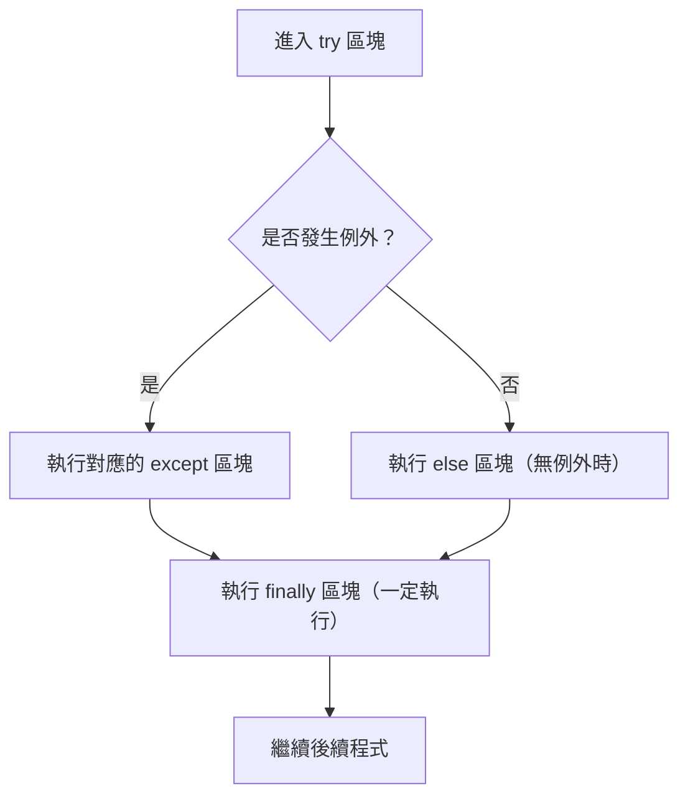

# Python 例外處理學習筆記（`try` / `except`）

在開發 Python 程式時，除了語法錯誤外，執行過程中常會遇到非預期狀況（例如：除以零、檔案不存在、使用者輸入格式錯誤等）。透過 **例外處理（Exception Handling）**，我們可以攔截並妥善處理這些錯誤，避免程式直接崩潰，並提供清楚的錯誤訊息。

---

## 1. 語法錯誤 vs. 執行期例外

| 類型 | 英文名稱 | 發生時機 | 能否用 `try / except` 捕捉 | 常見範例 |
| :--- | :--- | :--- | :--- | :--- |
| **語法錯誤** | `SyntaxError` | 程式碼執行前（解析階段） | 否（必須修正程式碼） | 忘記加冒號 `:`、縮排錯誤 |
| **執行期例外** | `Exception` | 程式執行期間（Runtime） | **是** | `10 / 0`、`int("abc")` |

### 常見內建例外一覽

| 例外名稱 | 觸發情境 | 範例 |
| :--- | :--- | :--- |
| `ZeroDivisionError` | 除數為 `0` | `10 / 0` |
| `ValueError` | 型態正確但數值無效或不合法 | `int("abc")` |
| `TypeError` | 資料型態不符 | `"10" + 5` |
| `IndexError` | 序列索引超出範圍 | `[1, 2][5]` |
| `KeyError` | 字典找不到指定的鍵（Key） | `{"a": 1}["b"]` |
| `FileNotFoundError` | 嘗試開啟不存在的檔案 | `open("none.txt")` |

---

## 2. `try ... except ... else ... finally` 完整結構



### 各區塊說明與範例

- **`try`**：放置「可能會發生錯誤」的程式碼。
- **`except`**：當 `try` 中發生指定類型的例外時執行，可用 `as e` 取得例外物件。
- **`else`**（選用）：只有當 `try` **完全沒有發生例外** 時才會執行。
- **`finally`**（選用）：無論是否發生例外，**一定會執行**（常用於關閉檔案、釋放連線等清理動作）。

```python
def safe_parse_and_divide(text_a, text_b):
    try:
        a = int(text_a)
        b = int(text_b)
        result = a / b
    except ValueError:
        print("錯誤：請輸入有效的整數！")
    except ZeroDivisionError as e:
        print(f"錯誤：無法除以零（{e}）")
    else:
        print(f"計算成功，結果為：{result}")
        return result
    finally:
        print("本次計算流程結束。")

safe_parse_and_divide("10", "2")
safe_parse_and_divide("10", "0")
safe_parse_and_divide("abc", "2")
```

---

## 3. 主動拋出例外：`raise`（結合 `calc.py` 實戰）

有時候我們不希望讓程式等到發生底層錯誤才中斷，而是想在函式入口就驗證條件，並拋出更符合業務語意的例外訊息。

參考本資料夾中的 [calc.py](file:///C:/Users/User/Documents/2026_11_11_Venv_exercise/2026_11_25/calc.py)：

```python
def divide(a, b):
    """回傳 a 除以 b 的結果；當 b 為 0 時拋出 ValueError。"""
    if b == 0:
        raise ValueError("除數不可為零")
    return a / b
```

### 為什麼這裡用 `raise ValueError("除數不可為零")`？
1. **明確的錯誤語意**：直接告訴呼叫端「傳入的參數 `b` 不合法」，並附上中文說明 `"除數不可為零"`。
2. **集中驗證邏輯**：呼叫端只要捕捉 `ValueError`，就能統一處理參數驗證失敗的情況。

呼叫端搭配 `try / except` 的寫法：

```python
from calc import divide

try:
    ans = divide(10, 0)
    print(ans)
except ValueError as err:
    print(f"輸入錯誤：{err}")
```

---

## 4. 在單元測試中驗證例外（結合 `tests/test_calc.py`）

寫完會主動 `raise` 例外的函式後，我們也應該寫測試來確保「該拋出例外時真的有拋出，且訊息正確」。

參考 [test_calc.py](file:///C:/Users/User/Documents/2026_11_11_Venv_exercise/2026_11_25/tests/test_calc.py)：

```python
import unittest
from calc import divide


class TestCalc(unittest.TestCase):
    def test_divide_normal(self):
        self.assertEqual(divide(10, 2), 5)
        self.assertAlmostEqual(divide(7, 2), 3.5)

    def test_divide_by_zero(self):
        with self.assertRaises(ValueError) as context:
            divide(10, 0)
        self.assertEqual(str(context.exception), "除數不可為零")
```

使用 `with self.assertRaises(ValueError) as context:` 可以：
1. 驗證呼叫 `divide(10, 0)` 是否真的引發了 `ValueError`。
2. 透過 `str(context.exception)` 進一步檢查錯誤訊息是否完全符合預期。

---

## 5. 最佳實踐與常見地雷

1. **避免使用裸露的 `except:`**
   - ❌ `except:` 會連同 `KeyboardInterrupt`、`SystemExit` 等系統訊號一起攔截，導致程式難以中斷或掩蓋真正的 Bug。
   - ✅ 永遠指定明確的例外類型，例如 `except ValueError:` 或 `except (ValueError, TypeError):`。
2. **`try` 區塊越精簡越好**
   - 只把「真正可能出錯的那幾行」放進 `try`，避免把大量無關程式碼包進去，造成難以追蹤錯誤來源。
3. **不要捕捉後什麼都不做（Silent Failure）**
   - ❌ `except ValueError: pass` 會讓問題靜悄悄地消失。
   - ✅ 至少記錄錯誤（log）、印出提示，或重新拋出例外（`raise`）。

---

## 6. 課後小練習

1. 試著為 `calc.py` 新增一個 `sqrt(x)` 函式：當 `x < 0` 時，主動拋出 `ValueError("不可對負數開根號")`。
2. 在 `tests/test_calc.py` 中補上對應的單元測試，使用 `assertRaises(ValueError)` 驗證負數輸入與錯誤訊息，並執行測試確認通過：
   ```powershell
   uv run python -m unittest discover -s tests -v
   ```
